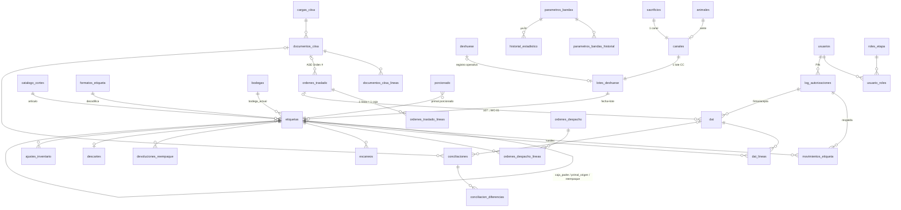

# Núcleo de inventario v10 — diseño propuesto

> Estado: **propuesta para revisión**. No toca código de la app ni `database.js`.
> Fuente: «Sistema de Trazabilidad v10» (8-oct-2026) y el análisis de brechas sobre `master` (`90afe52`).
> DDL completo, idempotente y probado en MySQL 8.0 (dos corridas seguidas sin errores): [`propuesta.sql`](./propuesta.sql).

## 1. Por qué el núcleo actual no alcanza

| Hoy | Problema frente al doc v10 |
|---|---|
| `movimientos_bodega.primal_id NOT NULL` | Cajas y paquetes se mueven sin registro (`cajas.bodega_actual_id` se pisa sin kardex en `ordenes-entrada/recibir`). |
| `bodegas.tipo` = salas (deshuese/custodia/…) | No existen 12, 107 ni WC-01, ni la diferencia custodia (107) vs. propio (WC-01). |
| `stickers.codigo_barras` generado (`arete-base36`, o `CUE-BOX-LOT`) | El doc manda leer la etiqueta CIISA y guardar el **código crudo** como llave. `/stickers/scan` busca por 4 columnas distintas. |
| `ordenes_entrada` / `ordenes_salida` | Recepción y despacho de cabecera: no hay escaneo pieza por pieza, conciliación caja ↔ paquetes ni PIN. |
| `custodia/mover` | Cualquiera mueve un primal sin firma ni aceptación; `responsable` es texto libre. |
| `usuarios.rol` admin/operador/viewer | Sin empresa, sin rol por etapa, sin PIN, sin `log_autorizaciones`. |
| `deshuese.numero_lote` = `DES-AAAAMMDD-<sacrificio_id>` | No es el lote CC de CIISA (fecha + número), que es lo que viene impreso en las etiquetas. |
| — | Sin bandas de rendimiento, sin carga ni conciliación de TRE/ASE/INV. |

Detalle adicional: `primales/:id/congelar` intenta `estado='congelado'`, que no existe en el ENUM (el error se traga). En el núcleo nuevo la congelación es un dato (`etiquetas.fecha_congelacion`), no un estado.

## 2. Principios del diseño

1. **La etiqueta es la unidad de inventario** a cualquier nivel (primal, caja, paquete). Una sola tabla `etiquetas` con `codigo_crudo UNIQUE`.
2. **La existencia se calcula, no se guarda**: suma de etiquetas en estado `disponible/apartada/bloqueada` por bodega. No hay columna de stock que se pueda desincronizar.
3. **Solo un documento mueve inventario**: DAT, recepción, orden de despacho, devolución/reempaque, descarte o ajuste. `movimientos_etiqueta` es append-only (triggers lo impiden) y siempre apunta a su documento.
4. **CIISA no mueve, concilia**: TRE, ASE e INV semanal se cargan después y se comparan contra lo que el sistema ya sabe.
5. **Toda excepción lleva PIN** y queda en `log_autorizaciones` (inmutable, incluye intentos fallidos).

## 3. Modelo de datos

Convenciones: InnoDB, `utf8mb4`, FKs hacia tablas existentes en `INT` (sus PK son `INT`), bitácoras en `BIGINT`, kg en `DECIMAL(10,3)`. Nunca hay FK sobre `VARCHAR` hacia tablas viejas, para no chocar con su collation. El `COMMENT` de cada columna está en el SQL; abajo va lo que importa para decidir.

### 3.1 Tablas existentes que se extienden

| Tabla | Columnas nuevas | Por qué |
|---|---|---|
| `usuarios` | `empresa ENUM('CIISA','WAGYU_CROSS')`, `pin_hash VARCHAR(100)` (bcrypt), `pin_definido_por INT`, `pin_definido_at DATETIME`, `pin_intentos_fallidos TINYINT`, `pin_bloqueado_hasta DATETIME` | §3 y §9. El PIN lo define el admin; con 10.000 combinaciones hace falta bloquear por intentos. `rol` queda como acceso grueso a la app. |
| `bodegas` | `naturaleza ENUM('fisica','virtual')`, `ambito_inventario ENUM('proceso','custodia','propio')`, `empresa_custodio`, `empresa_propietaria`, `codigo_ciisa VARCHAR(10)`, `cuenta_inventario_wc VARCHAR(30)`, `es_legacy TINYINT`; `tipo` pasa a NULL-able | La «tipo física/virtual» del doc se llama `naturaleza` porque `tipo` (salas) lo usan `Custodia.jsx` y `Maduracion.jsx`. En el corte, `tipo` se renombra a `sala`. |
| `catalogo_cortes` (= `catalogo_articulos`) | `nombre_en`, `sku_web`, `codigo_enlace`, `unidad_enlace ENUM('kg','unidad')` | Exportación a e-commerce y a Enlace (Enlace no acepta decimales en «Unid»). |
| `porcionado` | `etiqueta_primal_id INT` (FK `etiquetas`) | Liga el recorte declarado (`trimming_kg + bch_kg`) al arete para el balance. |

Bodegas sembradas (las `BOD-*` quedan `es_legacy=1`):

| Código | Nombre | Naturaleza | Ámbito | Custodio | `codigo_ciisa` |
|---|---|---|---|---|---|
| `DES` | Sala de deshuese CIISA | física | proceso | CIISA | — |
| `107` | EQTB Tempisque | **virtual** | **custodia** | CIISA | 107 |
| `MAD` | Maduración CIISA | física | proceso | CIISA | — |
| `12` | Paquetería CIISA | física | proceso | CIISA | 12 |
| `WC-01` | Bodega Wagyu Cross (tienda web) | física | **propio** | WAGYU_CROSS | — |

En todas, el propietario es Wagyu Cross.

### 3.2 Seguridad

| Tabla | Columnas clave | Por qué |
|---|---|---|
| `roles_etapa` | `codigo VARCHAR(40) PK`, `empresa`, `nombre`, `etapas SET(...)`, `puede_aceptar_dat` | 10 roles del §9 (7 CIISA, 3 WC). `etapas` define qué ve cada usuario de El Arreo. |
| `usuario_roles` | PK (`usuario_id`, `rol_codigo`), `asignado_por` | Un usuario puede tener varios roles de su empresa. El backend valida que el rol sea de la misma empresa que el usuario. |
| `log_autorizaciones` | `id BIGINT`, `usuario_id`, `accion VARCHAR(60)`, `objeto_tipo`, `objeto_id BIGINT`, `valor_anterior JSON`, `valor_nuevo JSON`, `resultado ENUM('ok','pin_invalido','pin_bloqueado','sin_permiso')`, `motivo`, `ip`, `dispositivo`, `created_at DATETIME(3)` | §3. Inmutable por trigger. Los documentos guardan `*_autorizacion_id` hacia aquí, así cada firma es verificable. |
| `consecutivos` | PK (`serie`, `anio`), `ultimo` | `DAT-AAAA-NNNN`, `OT-`, `OD-`, `DES-` sin huecos, tomados con `SELECT … FOR UPDATE` en la misma transacción. |

### 3.3 Cadena de identificadores (§4)

| Tabla | Columnas clave | Por qué |
|---|---|---|
| `canales` | `fecha_matanza DATE`, `numero_canal SMALLINT`, **UNIQUE (fecha_matanza, numero_canal)**, `sacrificio_id` UNIQUE → `sacrificios`, `animal_id`, `arete VARCHAR(7)`, pesos canal | El n.º de canal se repite cada día. Un sacrificio = un canal. |
| `lotes_deshuese` | `fecha_deshuese`, `numero_lote SMALLINT`, **UNIQUE (fecha_deshuese, numero_lote)**, `canal_id` UNIQUE, `animal_id`, `arete`, `deshuese_id` → `deshuese`, `cruce`, `sexo`, `kg_entrada`, `kg_deshuesado`, `estado` | Lote CC = un canal = un arete. Es lo que permite resolver el arete de una **caja** (que no lo trae) por fecha + lote. `cruce`/`sexo` alimentan bandas y tarifa BU. |

`arete` se denormaliza a propósito: el escáner lee arete o lote y la búsqueda tiene que ser directa.

### 3.4 Etiquetas

`formatos_etiqueta`: `tipo`, `version`, `longitud`, `simbologia`, `regex` (sintaxis JS con grupos con nombre), `descripcion`. Los layouts se configuran sin deploy mientras CIISA confirma campos (§8).

`etiquetas`:

| Grupo | Columnas |
|---|---|
| Llave | `id INT PK`, **`codigo_crudo VARCHAR(64) UNIQUE`**, `tipo ENUM('paquete','caja','primal','interna_previa')`, `formato_id` |
| Decodificado | `arete VARCHAR(7)`, `arete_confirmado TINYINT`, `animal_id`, `articulo_codigo VARCHAR(20)`, `articulo_id` → `catalogo_cortes`, `fecha_etiqueta DATE`, `lote_etiqueta VARCHAR(4)`, `lote_deshuese_id` → `lotes_deshuese`, `kg DECIMAL(10,3)`, `cruce`, `marmoleo TINYINT`, `box_codigo`, `campo_xxx`, `sufijo`, `decodificado JSON` |
| Jerarquía y origen | `caja_padre_id` (self), `primal_origen_id` (self), `origen_reempaque_id` (self), `origen_etapa ENUM('deshuese','porcionado','paqueteria','reempaque','migracion')`, `primal_legacy_id` → `primales` |
| Estado | `bodega_actual_id`, `estado ENUM('disponible','apartada','vendida','devuelta','descartada','bloqueada','transformada')`, `motivo_salida ENUM('pedido','mercadeo','descarte','ajuste')`, `dat_pendiente_id` → `dat`, `fecha_congelacion DATETIME`, `fecha_vencimiento DATE`, `activo` |

Decisiones:
- **`transformada`** se agrega a la lista de estados del pedido. Sin ese estado, un primal porcionado y los paquetes que salieron de él contarían dos veces, y lo mismo una caja desagregada y sus paquetes.
- **`dat_pendiente_id`** funciona como candado: una etiqueta en un DAT entregado y todavía no aceptado no puede entrar en otro DAT. La bodega no cambia hasta la aceptación. «En tránsito» se deriva de este campo y no es un estado aparte.
- `motivo_salida` cierra la lista de salidas de WC-01: `vendida + pedido|mercadeo` y `descartada + descarte|ajuste`.
- `kg` sale de la etiqueta (gramos/100 en paquete, centésimas en caja). Cuando la recepción pesa distinto, la diferencia va a conciliación y no se pisa el peso de la etiqueta.

### 3.5 Documentos y movimientos

| Tabla | Columnas clave | Por qué |
|---|---|---|
| `dat` | `numero VARCHAR(20) UNIQUE`, `tramo ENUM('deshuese_107','107_maduracion','maduracion_paqueteria','paqueteria_fondo','107_wc01')`, `bodega_origen_id`, `bodega_destino_id`, `orden_traslado_id`, `estado ENUM('borrador','entregado','en_recepcion','aceptado','rechazado','anulado')`, `unidades`, `kg_total`, `entregado_por`/`_at`/`entrega_autorizacion_id`, `aceptado_por`/`_at`/`aceptacion_autorizacion_id`, `aceptacion_modo ENUM('remota_individual','remota_bloque','recepcion_fisica')`, `motivo_rechazo` | Son exactamente dos firmas (entrega CIISA y aceptación WC), así que van como columnas y no hace falta una tabla `dat_firmas`. El `modo` distingue la aceptación en bloque de la recepción física, que es obligatoria en 107→WC-01. |
| `dat_lineas` | UNIQUE (`dat_id`, `etiqueta_id`), `kg_declarado`, `kg_recibido`, `estado_linea ENUM('pendiente','aceptada','rechazada','faltante','con_diferencia')` | Pieza por pieza. |
| `ordenes_traslado` (+ `_lineas`) | `numero` UNIQUE (`OT-AAAA-NNNN` = «Orden #» del ASE), origen 107, destino WC-01, `estado`, `emitida_autorizacion_id`, `documento_ase_id`. Línea: UNIQUE (`orden_id`, `etiqueta_caja_id`), `kg_caja`, `dias_congelacion`, `estado_linea` | Una línea = una caja master. Se valida ≥ 3 días de congelación al emitir. |
| `ordenes_despacho` (+ `_lineas`) | `numero` UNIQUE (`OD-…`), `bodega_origen_id` (WC-01 o 107), `tipo_destino ENUM('pedido_web','b2b','mercadeo')`, `referencia_pedido`, `cliente`, `estado`, `despacho_autorizacion_id`, `documento_ase_id`, `exportacion_enlace_id`. Línea: UNIQUE (`orden_id`, `etiqueta_id`), `kg`, `precio_unitario` | Mercadeo se trata como pedido y se reporta aparte. B2B directo desde 107 se concilia con el ASE a cliente. |
| `escaneos` | `id BIGINT`, `contexto ENUM('dat','recepcion_wc01','despacho','toma_fisica','consulta')`, `contexto_id`, `codigo_crudo`, `etiqueta_id`, `caja_contexto_id`, `resultado ENUM('ok','duplicado','desconocido','formato_invalido','codigo_no_coincide','peso_no_cuadra','caja_no_solicitada','bodega_incorrecta','estado_invalido')`, `usuario_id` | Registra toda lectura, incluidas las fallidas. Ninguna mueve inventario. Así quedan las alertas de recepción (Etapa 10) con evidencia. |
| `movimientos_etiqueta` | `id BIGINT`, `etiqueta_id`, `tipo ENUM('alta','dat','recepcion','apartado','liberacion','despacho','devolucion','reempaque','descarte','ajuste','transformacion','empaque_en_caja')`, bodegas origen/destino, `estado_anterior`/`estado_nuevo`, `kg`, **`documento_tipo` + `documento_id` NOT NULL**, `usuario_id`, `autorizacion_id` | Kardex append-only (triggers `trg_me_no_*`). Al no existir un `documento_tipo='manual'`, no se puede crear un movimiento suelto. |

### 3.6 CIISA, conciliación y excepciones

| Tabla | Columnas clave | Por qué |
|---|---|---|
| `cargas_ciisa` | `tipo_documento`, `metodo ENUM('excel_csv','pdf_ia','imagen_ia','manual')`, archivo + `archivo_sha256 UNIQUE`, `plantilla_version`, `estado` (incl. `pendiente_confirmacion`), `resultado JSON`, `cargado_por`, `confirmado_por`, `autorizacion_id` | Escala de captura del §11. El hash impide cargar dos veces el mismo archivo. Lo que extrae la IA espera confirmación humana, y la captura manual exige PIN. |
| `documentos_ciisa` (+ `_lineas`) | `tipo ENUM('TRE','ASE','INV_SEMANAL','DESHUESE','PORCIONADO','OTRO')`, `numero_ciisa`, **UNIQUE (tipo, numero_ciisa)**, `fecha_documento`, `estado_ciisa`, bodegas, `cliente_destino`, `orden_ref` (de Observaciones), `semana`, `carga_id`, `extraido_por_ia`, `estado_conciliacion`. Línea: `articulo_codigo`, `unidades`, `kg`, `lote`, `arete` | Una sola forma para TRE, ASE e INV. Cambia la regla de conciliación, no la tabla. TRE solo se acepta en estado `Aprobado`. |
| `conciliaciones` | `tipo ENUM('dat_tre','dat_ase','caja_paquetes','inv_custodia','orden_recepcion')`, período, referencias (`documento_ciisa_id`, `dat_id`, `etiqueta_caja_id`, `orden_traslado_id`), esperado/encontrado (kg, unidades), `tolerancia_pct`, `estado` | Una corrida de comparación. |
| `conciliacion_diferencias` | `tipo ENUM('articulo','unidades','kg','faltante','sobrante','codigo_no_coincide','peso_no_cuadra','caja_no_solicitada')`, esperado/encontrado, `resuelta`, `resolucion`, `resuelta_por`, `autorizacion_id` | Cada alerta se cierra con PIN del supervisor WC. |
| `devoluciones_reempaque` | `etiqueta_original_id`, `etiqueta_nueva_id`, `motivo`, `bodega_id`, `kg_antes`, `kg_despues`, `estado ENUM('pendiente','reempacada','descartada')`, `autorizacion_id NOT NULL` | La pieza es la misma, con bolsa y fecha nuevas, y por eso lleva código nuevo. La nueva apunta a la original con `origen_reempaque_id`, así no se pierde la trazabilidad. |
| `descartes` | `numero` UNIQUE, `etiqueta_id` UNIQUE, `bodega_id`, `kg`, `motivo`, `costo_kg`, `costo_total`, `devolucion_id`, `autorizacion_id NOT NULL` (admin), `exportacion_enlace_id` | Etapa 10: PIN de administrador, costo y export a Enlace. |
| `ajustes_inventario` | `bodega_id`, `etiqueta_id`, `codigo_crudo`, `tipo ENUM('faltante','sobrante','correccion_peso')`, `kg`, `motivo`, `autorizacion_id NOT NULL` | Salida por toma física. |
| `tarifas_bu` | `cruce`, `articulo_id` (NULL = general), `costo_kg`, `moneda`, `vigente_desde`, UNIQUE (cruce, articulo, vigencia) | Costo BU con tarifa F1 ≠ FB (§12). |
| `exportaciones_enlace` | `tipo ENUM('entradas','salidas')`, período, `archivo_ruta`, `lineas`, `generado_por` | Lote de `importar_documentos`. Despachos y descartes guardan en qué lote salieron, para no exportarlos dos veces. |

### 3.7 Bandas de rendimiento (§7.2)

| Tabla | Columnas clave |
|---|---|
| `parametros_bandas` | `eslabon ENUM('merma_transporte','matanza','deshuese','custodia','porcionado','fondo_traslado','venta')`, `cruce ENUM('F1','FB','F2','F3','*')`, `sexo ENUM('M','H','*')`, **UNIQUE (eslabon, cruce, sexo)**, `minimo_pct`, `maximo_pct`, `tolerancia_pct`, `tolerancia_kg`, `actualizado_por`, `autorizacion_id` |
| `parametros_bandas_historial` | `banda_id`, `origen ENUM('manual','propuesta_estadistica','semilla')`, `valor_anterior JSON`, `valor_nuevo JSON`, `usuario_id`, `autorizacion_id`, `created_at` |
| `historial_estadistico` | `banda_id`, `lote_deshuese_id`, `n_muestras`, `media_pct`, `desviacion_pct`, `propuesto_min`/`max` (μ ∓ 2σ), `estado ENUM('pendiente','aceptada','rechazada','vencida')`, `decidido_por`, `autorizacion_id` |

`*` sirve de comodín. El backend busca primero la banda específica (cruce, sexo) y, si no hay, cae al comodín. Semilla: transporte 3–6 %, deshuese 80–85 %, custodia 100 % ±0.5 kg, fondo/traslado 100 % ±2 %, venta balance = 0. Matanza (~60 %) queda sin rango hasta definirlo.

## 4. Diagrama

## 5. Invariantes que el backend debe garantizar

1. **Un escaneo sin firma no crea movimiento.** Escanear solo inserta en `escaneos` y en `dat_lineas` (DAT en `borrador`). El movimiento nace cuando el DAT se acepta.
2. **Un DAT sin aceptación no habilita la etapa siguiente.** Una etiqueta con `dat_pendiente_id` no entra en otro DAT, en una orden ni en un despacho, y su `bodega_actual_id` es la de origen hasta `aceptado`.
3. **107→WC-01 solo se acepta por recepción física** (`aceptacion_modo='recepcion_fisica'`) con cada caja abierta y sus paquetes escaneados. Se valida: el código del paquete corresponde a la caja (artículo + fecha + lote), Σ kg paquetes = kg caja ± banda `fondo_traslado` (2 %), y la caja está en la orden. Si falla, va a `conciliacion_diferencias` (`codigo_no_coincide`, `peso_no_cuadra`, `caja_no_solicitada`).
4. **La existencia por bodega es la suma de etiquetas** con estado `disponible/apartada/bloqueada` en esa bodega (vista `v_existencias`). Nunca se guarda en una columna aparte.
5. **La caja no trae arete.** Se resuelve por `fecha_etiqueta + lote_etiqueta → lotes_deshuese.arete` (`arete_confirmado=0`) y se confirma al escanear sus paquetes, que sí lo traen. Si un paquete trae otro arete, salta la alerta `codigo_no_coincide`.
6. **No hay doble conteo.** Al porcionar, el primal pasa a `transformada`. Al desagregar una caja en recepción, la caja pasa a `transformada` y sus paquetes heredan la bodega. Una etiqueta reemplazada por reempaque queda `devuelta` y deja de contar.
7. **Toda transición de estado escribe un `movimientos_etiqueta`** en la misma transacción, con `documento_tipo/documento_id`. Las correcciones se hacen con un movimiento inverso, nunca con UPDATE ni DELETE.
8. **Salidas de WC-01 en lista cerrada**: pedido, mercadeo, descarte y ajuste por toma física. Cualquier otra transición fuera de WC-01 se rechaza.
9. **PIN**: se verifica con bcrypt contra `usuarios.pin_hash`. Antes de ejecutar la acción se inserta `log_autorizaciones` (también los intentos fallidos) y su id se guarda en el documento. Si el PIN es de otro usuario, de otra empresa o de un rol sin permiso, la respuesta es `sin_permiso`. Tras N fallos, el PIN se bloquea temporalmente.
10. **Documentos CIISA no tocan etiquetas**: solo crean `conciliaciones`. TRE en estado distinto de `Aprobado` no se concilia.
11. **Traslado a WC-01 solo de cajas con ≥ 3 días de congelación** (`fecha_congelacion`), validado al emitir la orden y otra vez al firmar el DAT.
12. **Bandas**: el cambio manual exige PIN de admin y escribe historial. Las propuestas μ ± 2σ quedan `pendiente` y solo actualizan la banda si el admin las acepta.
13. **Unicidad**: `codigo_crudo`, (fecha_matanza, numero_canal), (fecha_deshuese, numero_lote) y (tipo, numero_ciisa) son UNIQUE en base. El backend responde 409 y no reintenta generando otro código, como hace hoy `stickers.js`.

## 6. Vistas

- `v_existencias`: base de inventario (etiquetas activas, estado `disponible/apartada/bloqueada`, más `en_transito` derivado).
- `inventario_custodia`: `v_existencias` con bodega `107`. Se concilia contra «INV WAGYU SEMANA xx».
- `inventario_wc01`: `v_existencias` con bodega `WC-01`, con nombre ES/EN y SKU. Es la base del export al e-commerce, que toma solo `tipo='paquete'` y nunca cajas.
- `v_existencias_resumen`: unidades y kg por bodega × artículo × tipo.
- `v_balance_arete`:
  `kg_deshuesado` (etiquetas con `origen_etapa='deshuese'`) − (vendido + mercadeo + descartado + ajuste + custodia 107 + WC-01 + en proceso + recorte declarado + merma de reempaque) = `diferencia` (banda `venta`: 0).
  Solo cuenta «hojas»: excluye `transformada` y las piezas reemplazadas por reempaque.
  Se probó con datos sintéticos: primal de 10 kg porcionado en 5 + 2.5 + 1.5 kg sin declarar recorte da `diferencia = 1.000`, que es justo el recorte no declarado.

Los productos de paquetería que mezclan aretes (carne molida, chorizo) se registran con `arete NULL` y quedan fuera del balance por arete. Su trazabilidad sigue en `paqueteria_fuentes`. El recorte que se fue a molida ya está contado como `kg_recorte_declarado`.

## 7. Reaprovechamiento de lo existente

**Quedan igual**: `animales` (`numero_trazabilidad` = arete), `pesajes`, `eventos_salud`, `reproduccion`, `potreros`, `movimientos` (es de potreros, no de bodega), `transporte`, `sacrificios`, `cortes`, `deshuese` (registro operativo y PDF), `primales` (dato de proceso: tipo, marmoleo, maduración), `temperaturas_maduracion`, `productos_paqueteria`, `paqueteria_fuentes` y `config_planta`.
**Se extienden**: `usuarios`, `bodegas`, `catalogo_cortes` y `porcionado` (§3.1).
**Se reemplazan** y quedan solo lectura después del corte:

| Viejo | Nuevo | Mapeo |
|---|---|---|
| `bodegas` BOD-* | bodegas v10 | BOD-DES→`DES`, BOD-CUS→`107`, BOD-MAD→`MAD`, BOD-POR→`12` (⚠ confirmar que el porcionado se hace en paquetería), BOD-DSP→ sin equivalente (inactiva). Se repuntan las FKs `primales.bodega_actual_id`, `deshuese.bodega_origen_id` y `temperaturas_maduracion.bodega_id`. |
| `primales` vivos | `etiquetas` tipo `primal` | `codigo_crudo = 'LEGACY-P-' + primales.codigo` mientras no exista la etiqueta CIISA real; `kg = peso_kg`; `arete` desde `animales.numero_trazabilidad`; `bodega_actual_id` mapeada; `estado`: en_custodia/en_maduracion→`disponible`, porcionado→`transformada`, descartado→`descartada`+`descarte`; `fecha_congelacion = fecha_congelado`; `primal_legacy_id = id`; `origen_etapa='migracion'`. Al escanear la etiqueta real, `codigo_crudo` se reemplaza con PIN (`log_autorizaciones`, acción `reetiquetado`). |
| `cajas` | `etiquetas` tipo `caja` | `codigo_crudo = 'LEGACY-C-' + codigo`, `kg = peso_total_kg`, estado abierta/completa→`disponible`, despachada→`vendida`+`pedido`, devuelta→`devuelta`. |
| `stickers` | `etiquetas` tipo **`interna_previa`** | `codigo_crudo = codigo_barras` (o `CUE-BOX-LOT`), `activo = 0`, `estado = 'bloqueada'`, `caja_padre_id` → caja migrada, `arete` desde `animal_id`, `articulo_codigo = corte_codigo/codigo_cue`, `kg = peso_kg`, `marmoleo`, `lote_etiqueta = codigo_lot`. No cuentan en inventario salvo que se activen a mano, con PIN y conciliando contra la etiqueta CIISA. |
| `movimientos_bodega` | `movimientos_etiqueta` | Una fila por movimiento con `documento_tipo='migracion'`, `documento_id = movimientos_bodega.id`, `tipo`: ingreso_custodia→`dat`, paso_maduracion→`dat`, recepcion_entrada→`recepcion`, otro/salida→`despacho`. `usuario_id` = usuario técnico «migracion» (el `responsable` de texto va al JSON de `log_autorizaciones` de la migración). |
| `ordenes_entrada(_items)` | `ordenes_traslado` + `dat` 107_wc01 | Solo históricas: se exportan a CSV y no se migran como órdenes v10. No tienen escaneo ni firma, así que no cumplen las invariantes. |
| `ordenes_salida(_items)` | `ordenes_despacho(_lineas)` | Despachadas → `estado='despachada'`, `tipo_destino='b2b'`, líneas por caja migrada. Pendientes → se recrean a mano. |
| `devoluciones` | `devoluciones_reempaque` | `motivo` se mapea 1:1 (`perdida_vacio`, `producto_danado`, `error_empaque`; `vencido`→`otro`). `reprocesado=1` → `reempacada`. `autorizacion_id` → registro de migración. |

## 8. Plan de migración

1. **Crear** (sin downtime): correr `propuesta.sql` (extiende tablas, crea las nuevas, vistas, triggers y semillas). No rompe la app actual: solo agrega columnas NULL-able y tablas nuevas, y `bodegas.tipo` sigue existiendo.
2. **Usuarios**: el admin asigna `empresa`, roles y PIN a cada usuario y se crea el usuario técnico `migracion`. Sin PIN no se firma nada.
3. **Backfill de la cadena**: `canales` desde `sacrificios` (n.º de canal según el reporte CIISA, ⚠ hoy no se captura) y `lotes_deshuese` desde `deshuese` (fecha + lote CC real, que se digita desde el PDF de deshuese).
4. **Backfill de inventario** (en una transacción por tabla, en este orden): bodegas → primales → cajas → stickers → movimientos → órdenes → devoluciones, según el mapeo de §7.
5. **Toma física de corte** en 107 (contra el último INV WAGYU SEMANA) y en WC-01, escaneando las etiquetas CIISA reales. Lo que aparece y no estaba se registra como `ajustes_inventario` con PIN admin. Esta toma fija el saldo inicial confiable.
6. **Corte**: se congelan las escrituras en `movimientos_bodega`, `stickers`, `cajas`, `ordenes_entrada` y `ordenes_salida` (endpoints a 410 o solo lectura). `bodegas.tipo` se renombra a `sala`, `naturaleza` pasa a `NOT NULL` y el frontend pasa a usar las vistas.
7. **Paralelo 2 semanas**: cada carga de TRE/ASE/INV se concilia y las diferencias se revisan a diario.
8. **Retiro**: las tablas viejas se renombran a `legacy_*`. No se borran.

## 9. Endpoints nuevos (sin implementar)

| Método y ruta | Qué hace |
|---|---|
| `POST /api/auth/pin/verificar` | Valida el PIN del usuario para una acción. Escribe `log_autorizaciones` y devuelve `autorizacion_id` de un solo uso y corta vida. |
| `PUT /api/usuarios/:id/pin` | El admin define o resetea el PIN, con su propio PIN. |
| `POST /api/etiquetas/decodificar` | Recibe el código crudo y devuelve los campos decodificados y la etiqueta existente, si la hay. No escribe nada. |
| `GET /api/etiquetas/:codigo` | Trazabilidad completa: cadena hasta el arete, kardex y documentos. |
| `POST /api/dat` · `POST /api/dat/:id/escaneos` | Crea un DAT en borrador y agrega etiquetas escaneadas (valida candado, bodega y estado). |
| `POST /api/dat/:id/entregar` | Firma de CIISA con PIN: `entregado`, pone el candado `dat_pendiente_id` y asigna el consecutivo. |
| `POST /api/dat/aceptar` | El supervisor WC acepta uno o varios DAT (en bloque) con PIN y genera los movimientos. |
| `POST /api/dat/:id/rechazar` | Rechazo con motivo y PIN, libera los candados. |
| `POST /api/ordenes-traslado` · `POST /api/ordenes-traslado/:id/emitir` | Crea la orden por cajas y la emite con PIN (valida ≥ 3 días de congelación). |
| `POST /api/recepciones/:datId/escaneos` | Recepción en WC-01: escanear caja, escanear paquetes y validar código, peso y orden en vivo. |
| `POST /api/recepciones/:datId/cerrar` | Cierra la recepción: aceptación física, desagrega cajas y crea conciliaciones si hay diferencias. |
| `POST /api/ordenes-despacho` · `/:id/escaneos` · `/:id/despachar` | Despacho por etiqueta: apartado, salida y movimientos. |
| `POST /api/devoluciones-reempaque` · `/:id/reempacar` | Devolución y reempaque con PIN de supervisor. |
| `POST /api/descartes` | Descarte con PIN de admin y costo BU. |
| `POST /api/ajustes-inventario` | Ajuste por toma física con PIN de admin. |
| `POST /api/cargas-ciisa` · `POST /api/cargas-ciisa/:id/confirmar` | Sube el Excel/CSV/PDF, parsea con plantilla o IA y, si hace falta, pide confirmación humana. |
| `POST /api/conciliaciones/ejecutar` | Corre DAT↔TRE, DAT↔ASE o INV↔custodia para un documento o un período. |
| `POST /api/conciliaciones/diferencias/:id/resolver` | Resolución con PIN del supervisor WC. |
| `GET /api/inventario/custodia` · `GET /api/inventario/wc01` · `GET /api/balance/:arete` | Lectura de las vistas. |
| `GET/PUT /api/bandas` · `POST /api/bandas/propuestas/:id/aceptar` | Ver y editar bandas con PIN, y aceptar propuestas μ ± 2σ. |
| `POST /api/exportaciones/enlace` · `GET /api/exportaciones/ecommerce` | Archivo `importar_documentos` y feed de paquetes de WC-01. |

## 10. Decisiones abiertas — requieren respuesta de Wagyu Cross / CIISA

> ⚠ El SQL deja estos puntos parametrizados (`formatos_etiqueta`, columnas NULL-able) para no bloquear el desarrollo.

| # | Pregunta | Para quién | Impacto |
|---|---|---|---|
| A1 | **Campo «XXX» de la etiqueta de caja**: ¿qué significa (planta, turno, operario, consecutivo)? 12-oct: literal `XXX` en las 2 cajas reales. | CIISA | Puede ser parte de la unicidad de la caja. |
| A2 | **Sufijos** de caja y primal: ¿qué codifican? 12-oct: anchos confirmados con etiquetas reales; sufijo `11` en todas las cajas y `10` en todos los primales conocidos. | CIISA | Hoy los regex de caja y primal son provisionales. |
| A3 | ~~**Lote de 4 dígitos en caja vs. 2 en paquete/primal**~~ **Respondida (cliente, 12-oct)**: es el mismo n.º de deshuese (posición) con `00` delante; la fecha del lote de la caja es la del deshuese. | CIISA | Es lo que resuelve el arete de la caja. |
| A4 | **¿Quién imprime la etiqueta de paquete** (28 caracteres, con arete y marmoleo)? ¿CIISA en paquetería o WC al reempacar? ¿Qué formato lleva el reempaque? | WC + CIISA | Define si el reempaque genera una etiqueta CIISA o una propia de WC, y su formato. |
| A5 | **Simbología** de cada etiqueta (Code 128, GS1-128, Code 39 en primal): ¿hay caracteres de control o prefijos AI que el escáner entregue? | CIISA | Afecta la normalización de `codigo_crudo`. |
| A6 | **Formato real de `importar_documentos` de Enlace**: columnas, tipos de documento, código de bodega, manejo de lote = arete y redondeo de «Unid». | WC (contabilidad EQTBL) | Sin esto no se implementa la exportación. |
| A7 | **Fecha de inicio de congelación** para la regla de ≥ 3 días: ¿la fecha de la etiqueta, un evento registrado o la fecha del DAT a congelado? | WC | `etiquetas.fecha_congelacion`. |
| A8 | ¿La **maduración** físicamente está dentro de 107 (custodia) o es una sala aparte? Hoy está modelada como `proceso`. | WC + CIISA | Cambia qué cuenta en `inventario_custodia` y qué espera el INV semanal. |
| A9 | ¿El **porcionado** ocurre en Paquetería 12? ¿Qué pasa con BOD-DSP? | CIISA | Mapeo de bodegas legacy. |
| A10 | Tarifas BU F1/FB: ¿por kg general o por artículo? ¿Moneda? | WC | `tarifas_bu`. |
| A11 | Rango exacto de la banda de matanza (~60 %) y bandas por cruce y sexo iniciales. | WC | Semilla de `parametros_bandas`. |
| A12 | N.º de canal: ¿viene en algún reporte CIISA que se pueda cargar, o se digita? | CIISA | Backfill de `canales`. |
| A13 | Productos de paquetería multiarete (molida, chorizo): ¿llevan etiqueta CIISA propia y van a WC-01 como inventario? | WC | Hoy quedan fuera del balance por arete. |
| A14 | Número de intentos fallidos y duración del bloqueo de PIN. | WC | Política de seguridad. |
| A15 | **Fecha del paquete ≠ fecha del deshuese** (etiqueta real 12-oct: código 23/11/24, lote legible 22/11/24). La caja lleva la fecha del deshuese y el paquete la de producción. ¿Cómo se valida «paquete corresponde a la caja» (invariante 3)? | CIISA | Comparar fecha literal puede rechazar paquetes buenos; ver `docs/etiquetas-ciisa/etiquetas-reales-2026-10-12.md` §2.2. |
| A16 | **Paquete FB con contenido racial F1** (26338 «FB NEW YORK STEAK», código `…F111`): ¿error de impresión de CIISA o el campo no es el cruce del animal? | CIISA | Decide si `genetica_cruzada` bloquea o solo alerta. |
